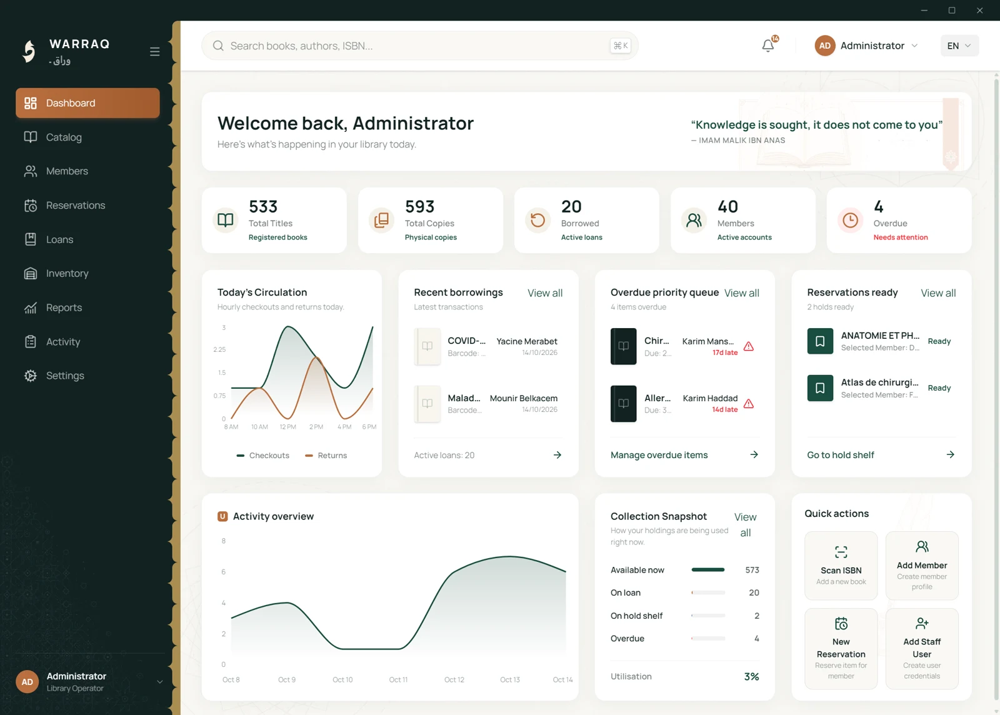
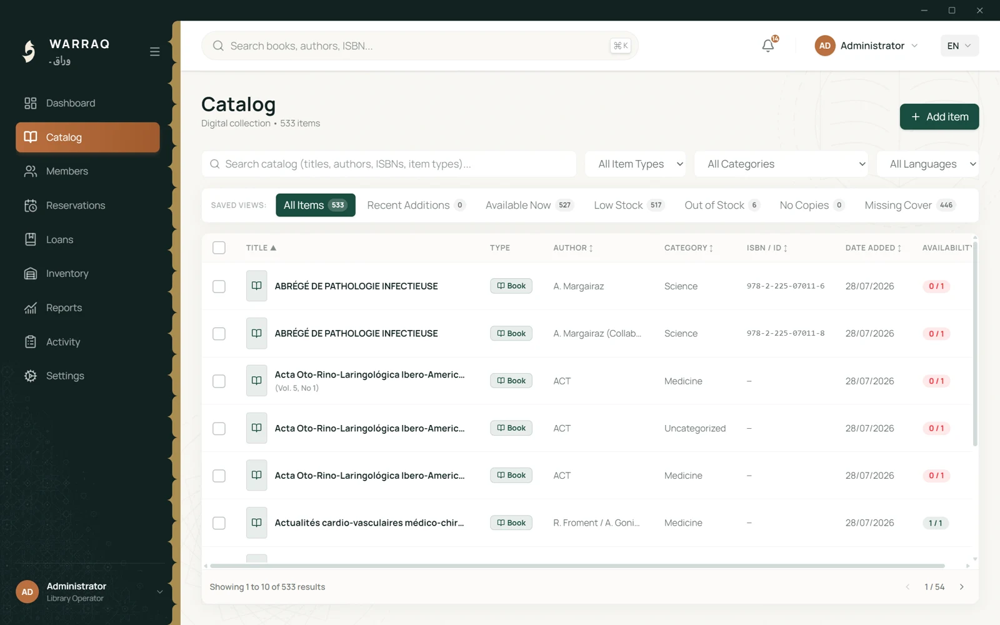
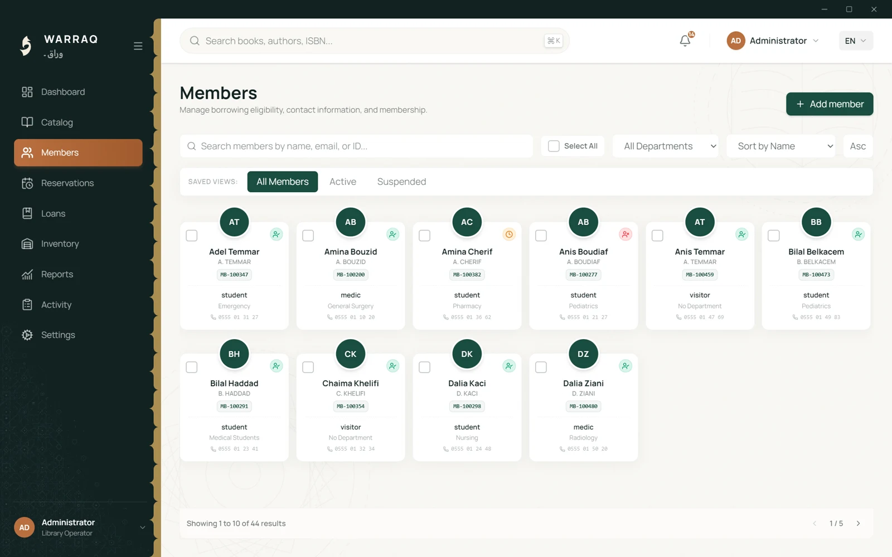
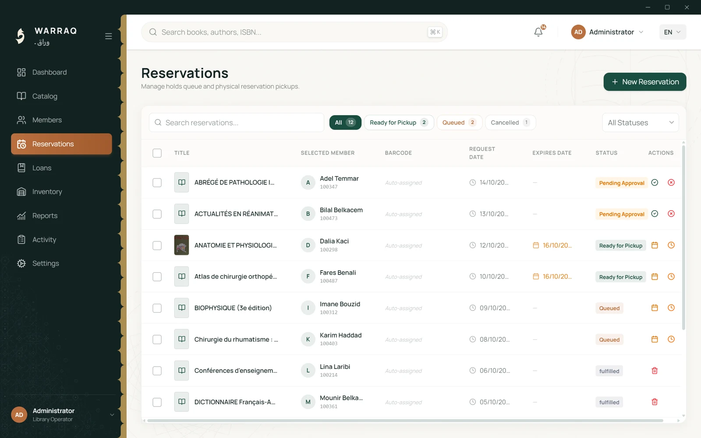
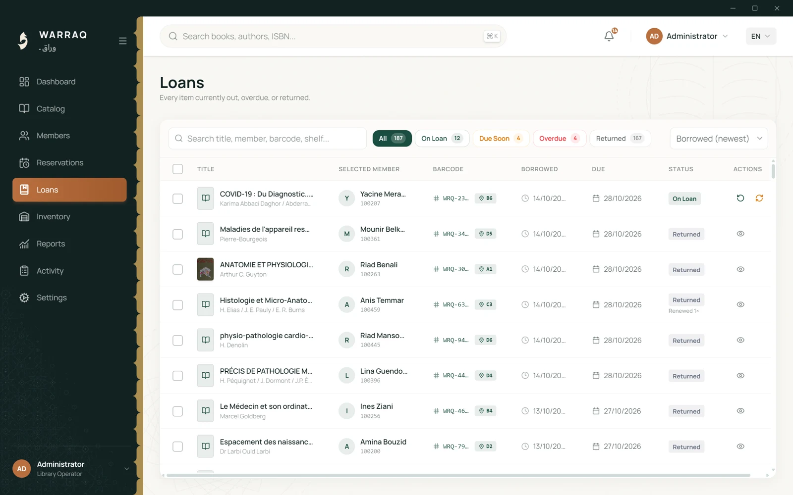
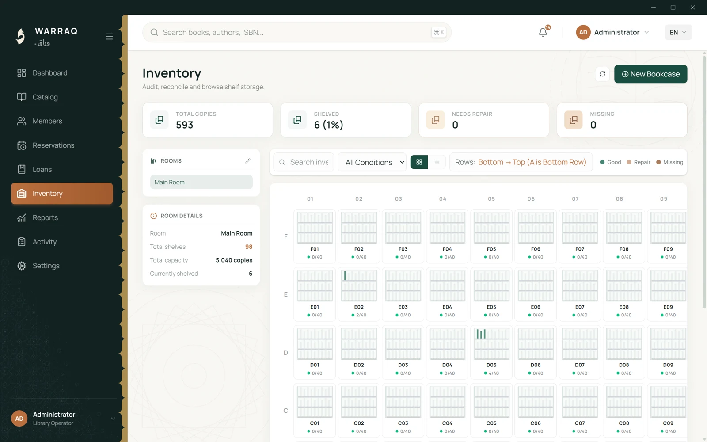
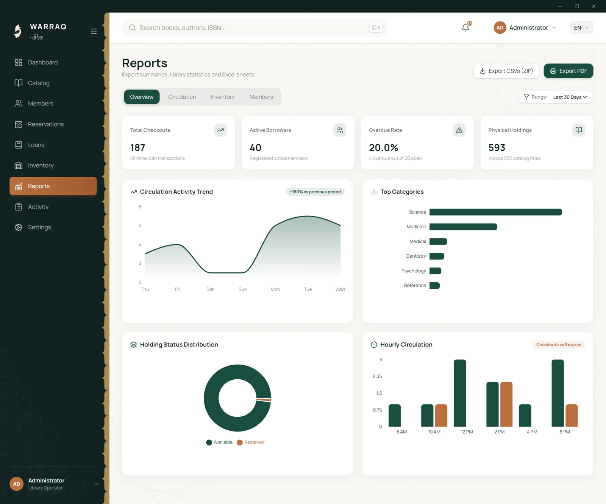
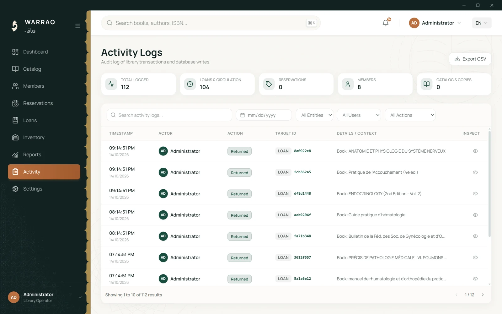
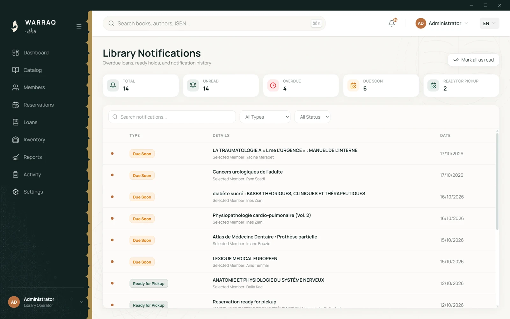
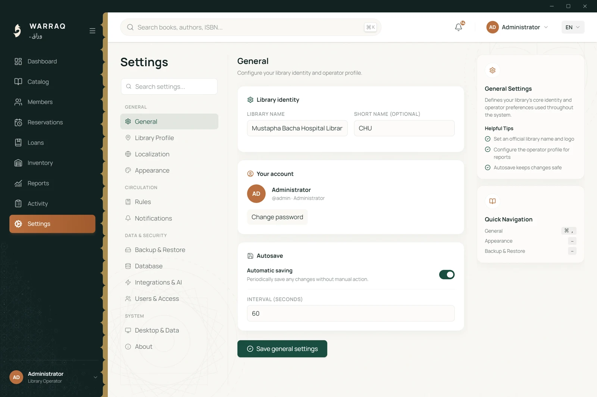

<h1 style="font-family: Arial, sans-serif; font-size: 36px; color: #0F766E; display: flex; align-items: center; gap: 12px; border-bottom: 3px solid #0F766E; padding-bottom: 8px;">
  Warraq — Library Management System
</h1>

Warraq is a desktop system for the Mustapha Bacha Hospital library. It supports catalogue work, circulation, inventory, member records, reporting, and configurable metadata integrations, backed by a shared Supabase (Postgres) database — the same data the [public catalog website](../Website) reads.

**Status:** The most actively developed project in the portfolio. Core workflows (catalogue, circulation, inventory, members, reservations, reporting) are working, with recent commits polishing localization, notifications, and cover-image backfill. No Windows 7 support (WebView2 dependency). Catalog import currently covers books only — no FYP/journal import path yet.

---

## Tech Used


---

## Features

- Dashboard, catalogue, circulation activity, inventory, members, reservations, and reports
- Shared Supabase (Postgres) backend — every desktop install reads/writes the same data, ready for a future public website
- Books / FYP (PFE) / journals item types, each with ISBN + Dewey + NLM ("Cote") classification fields
- Fixed shelf model per room: six lettered shelves (A–F) plus one larger floor shelf
- Member roles (visitor / student / staff / medic) with internal vs. external reservation rules — visitors and single-copy titles are internal-only, and reservations require admin accept/decline (with a member-ban option)
- Arabic, English, and French interface translations (RTL-aware)
- Barcode support and image upload controls
- JSON import for books/members
- Optional Open Library, Google Books, and Groq metadata providers
- Custom titlebar, persistent window state, single-instance behavior, shortcuts, and close-to-tray workflow
- Stronghold-backed local secrets and scoped Tauri capabilities; the Supabase service-role key never leaves the Rust process

---

## Screenshots

<table>
  <tr>
    <td width="50%"><br/><b>Dashboard</b><br/>Titles, copies, active loans, today's circulation, overdue queue and reservations ready for pickup.</td>
    <td width="50%"><br/><b>Catalog</b><br/>Books, theses and journals with saved views, availability per title and cover status.</td>
  </tr>
  <tr>
    <td width="50%"><br/><b>Members</b><br/>Member cards by role and department, with search, saved views and bulk selection.</td>
    <td width="50%"><br/><b>Reservations</b><br/>Pending approvals, ready holds and the queue, with accept and decline actions.</td>
  </tr>
  <tr>
    <td width="50%"><br/><b>Loans</b><br/>Every loan with on loan, due soon, overdue and returned filters, plus renew and return actions.</td>
    <td width="50%"><br/><b>Inventory</b><br/>Rooms, bookcases and shelf occupancy for auditing the physical collection.</td>
  </tr>
  <tr>
    <td width="50%"><br/><b>Reports</b><br/>Circulation trend, top categories, holding status and hourly activity, with CSV and PDF export.</td>
    <td width="50%"><br/><b>Activity</b><br/>Audit trail of checkouts, returns and database writes, filterable by user, entity and action.</td>
  </tr>
  <tr>
    <td width="50%"><br/><b>Notifications</b><br/>Overdue loans, due soon alerts and reservations ready for pickup.</td>
    <td width="50%"><br/><b>Settings</b><br/>Library identity, circulation rules, localization, backups, integrations and staff access.</td>
  </tr>
</table>

> The screenshots use generated demo data: invented members and loan history over the real catalog, so no member records are published.

## Project Structure

```text
src/
|-- app/                    # Application shell and providers
|-- components/             # Layout and shared UI components
|-- data/                   # Supabase client, auth, repositories
|-- i18n/                   # Arabic, English, and French translations
|-- sections/               # Dashboard, catalogue, inventory, members, reports, settings
|-- store/                  # UI state + shared library settings
|-- utils/                  # ISBN, dates, currency, and metadata helpers
`-- main.tsx                # React entry point

src-tauri/
|-- capabilities/           # Tauri permission definitions
|-- src/                    # Native tray, window, and Supabase-admin logic
|-- tauri.conf.json         # Build and desktop configuration
`-- Cargo.toml               # Rust dependencies

supabase/
|-- migrations/             # Postgres schema, RLS policies, and business-rule functions
`-- tests/                  # SQL tests, run against a throwaway local Postgres

scripts/
`-- import_catalog.py       # One-off import of the recovered book inventory (see below)
```

---

## Getting Started

### Prerequisites

- Node.js 18+
- pnpm
- Rust toolchain
- Tauri system dependencies for your operating system
- A Supabase project (see **Environment variables** below)

### Environment variables

Copy `.env.example` to `.env` and fill in:

| Variable | Used by | Notes |
| --- | --- | --- |
| `WARRAQ_ADMIN_USERNAME` / `WARRAQ_ADMIN_PASSWORD` | Rust (bootstrap) | Creates the one administrator account the first time the app runs against an empty `profiles` table. |
| `WARRAQ_ADMIN_EMAIL` | Rust (bootstrap) | Optional — if unset, the bootstrap admin gets a synthetic `<username>@warraq.local` identity. |
| `PROJECT_ID`, `PUBLISHABLE_KEY`, `SECRET_KEY` | Rust only (`src-tauri/src/admin.rs`) | `SECRET_KEY` is the Supabase **service-role** key — it must never be exposed to the frontend. |
| `DIRECT_STRING` | Manual migrations only | Direct Postgres connection for running SQL in `supabase/migrations/`; resolves over IPv6 only from most networks — use the Supavisor pooler instead (see the comment in `.env.example`). |
| `VITE_SUPABASE_URL`, `VITE_SUPABASE_ANON_KEY` | Frontend (Vite) | The anon/publishable key is meant to be public — every table it can reach is protected by Postgres Row Level Security, not by keeping this key secret. |

### Install and run

```bash
pnpm install
cp .env.example .env   # fill in the variables above
pnpm tauri dev
```

For frontend-only work, run `pnpm dev`. Note that admin/staff account management (create/reset-password/delete) requires the Tauri runtime, since those go through the Rust `admin_*` commands.

### Editions: public and client

Warraq builds in two editions from the same code. The difference is whether the `.env` values are inside the installer.

| | Public | Client |
| --- | --- | --- |
| Command | `pnpm build:public` | `pnpm build:client` |
| `.env` baked in | No | Yes: project, service-role key, admin login |
| First run | Setup screen: the user connects their **own** Supabase project | Opens straight to sign-in |
| Where it goes | GitHub Releases | Handed to the client directly. Never uploaded publicly |

Both scripts build the installer, then scan the program and web bundle for every value in `.env`. A public build that contains one fails and nothing is copied; the installer and its SHA-256 land in `release/public` or `release/client`. The switch is the `client` Cargo feature (`src-tauri/build.rs`) plus `WARRAQ_EDITION=public` for Vite (`vite.config.ts`), so a plain `pnpm tauri build` is a public build and cannot leak by accident.

#### First-run setup (public edition)

A fresh install has no database, so it opens a three step setup (`src/sections/Setup.tsx`):

1. **Connect.** Paste the project URL, the publishable key and the secret (service role) key from Supabase, Project Settings, API Keys. The project URL and publishable key are kept in the webview's local storage. The secret key goes to Rust and is stored in the Windows Credential Manager (`src-tauri/src/connection.rs`), never where the webview can read it.
2. **Tables.** Copy or save `src/assets/schema.sql`, run it once in the project's SQL editor, then press Check.
3. **Administrator.** Choose the first admin's username and password. If the project already has one, skip the step.

Settings, Database shows which project is in use and can reset the connection. Only hosted Supabase projects (`*.supabase.co`) are supported, because the app's content security policy allows nothing else.

`src/assets/schema.sql` is the migrations in `supabase/migrations` joined in order. After adding a migration, run `pnpm schema` to regenerate it; `pnpm test` fails when the two drift, and `pnpm test:sql` applies the script to an empty database.

---

## Available Scripts

```bash
pnpm dev          # Start Vite
pnpm build        # Type-check and build frontend assets
pnpm typecheck    # Run TypeScript checking
pnpm test         # Run Vitest tests
pnpm test:sql     # Apply every migration to a temp local Postgres and run supabase/tests (needs initdb/pg_ctl/psql on PATH)
pnpm rust:check   # Check the Rust/Tauri application
pnpm tauri dev    # Run the desktop app
pnpm tauri build  # Build the production desktop installer (Windows/macOS/Linux)
pnpm build:public # Public installer (no .env inside), scanned for secrets
pnpm build:client # Client installer (.env baked in). Do not publish
pnpm schema       # Regenerate src/assets/schema.sql from supabase/migrations
```

---

## Accounts and Sign-In

Warraq requires signing in — there is no anonymous access. Sign-in uses **Supabase Auth**; the login form takes a username, which is resolved to the corresponding Supabase Auth email server-side (`resolve_login_email` — see `supabase/migrations/0008_login_helper.sql`) before authenticating.

On first launch, if no staff profiles exist yet, the app reads `WARRAQ_ADMIN_USERNAME` / `WARRAQ_ADMIN_PASSWORD` (and optionally `WARRAQ_ADMIN_EMAIL`) and creates the one administrator account via the Supabase Admin API — Rust only, using the service-role key, never sent to the frontend.

Once signed in, an administrator manages every other account from **Settings → Users**: creating staff/admin accounts, resetting passwords, and enabling/disabling access without deleting anyone's borrowing or audit history. The last active administrator can't be demoted, disabled, or deleted (enforced by a Postgres trigger on `profiles`, not just the UI), so the library can never be locked out.

---

## Database

All schema, Row Level Security policies, and business-rule functions (checkout/return, reservation accept/decline, member bans, shelf provisioning) live in `supabase/migrations/`, applied directly to the project via `psql`. There is no `supabase` CLI dependency — the migrations are plain numbered `.sql` files, applied in order.

New installs do not apply them one by one: `src/assets/schema.sql` is the same migrations as a single script, generated by `pnpm schema` and verified against an empty Postgres by `pnpm test:sql`.

Reservation holds expire on their own: `sweep_reservations()` (migration 0022) moves overdue `ready` holds to `expired`, returns their copies to the shelf, and promotes the next queued member. The App runs it at boot and whenever it loads reservations; if `pg_cron` is enabled on the project, the migration also schedules it every 15 minutes so the Website stays accurate while the App is closed.

Circulation rules and the library's institutional profile (name, address, loan/renewal limits, fines, reservation durations) live in the shared `library_settings` table (Settings → General/Library Profile/Rules/Fines), not in per-device preferences — every staff device sees the same rules. Purely local UI preferences (theme, accent color, font size, close-to-tray, integration API keys) stay in the Tauri Store per device.

### Catalog import

`scripts/import_catalog.py` parses the book inventory recovered from `documents/التصنيف/*.docx` (N°/Title/Author/Year/Cote/Observation tables) into a reviewable SQL file, deduplicating cross-file draft copies and grouping repeated rows into one book with multiple physical copies:

```bash
python scripts/import_catalog.py         # writes scripts/import_catalog.sql + prints a summary
# review scripts/import_catalog.sql, then:
psql -h <pooler-host> -U <project-ref-user> -d postgres -v ON_ERROR_STOP=1 -f scripts/import_catalog.sql
```

This only imports **books** — the source `.docx` files contain no FYP (PFE) or journal records, so those need separate data entry or a future import source.

---

## Known Limitations / Backlog

- **Windows 7 build**: not currently supported. Tauri v2 desktop apps depend on Microsoft's WebView2 runtime, which Microsoft does not support on Windows 7, and current Rust toolchains have dropped Windows 7 as a baseline target. A Win7 build would need a pinned legacy Rust toolchain and an alternate target triple, with no guarantee WebView2 itself would run — deferred pending a decision on whether that investment is worthwhile.

---

## Everyday Workflows

- **Cataloguing:** Search or add records, enrich them with metadata providers, and maintain copy information.
- **Circulation:** Track active loans, member activity, reservations, and returns.
- **Inventory:** Review rooms and their fixed A–F + floor shelves, then record copy condition and availability.
- **Reservations:** Internal (in-library) or external (take-home) requests go to `pending`; an admin accepts, declines, or bans the requesting member.
- **Reporting:** Use the reporting and export views to share library activity without exporting secure credential data.

---

## Keyboard and Tray Behavior

- `Ctrl/Cmd + K` opens the command palette.
- `/` focuses the main search workflow.
- `Ctrl/Cmd + ,` opens settings.
- The system tray can restore the app, open search or circulation, open settings, and quit explicitly.
- When configured, closing the window hides it to the tray instead of terminating the application.

---

## License

This project is licensed under the [PolyForm Noncommercial License 1.0.0](./LICENSE). It may be used, modified, and shared strictly for non-commercial purposes. Any commercial use, sale, integration into paid software, or paid service usage is prohibited.
